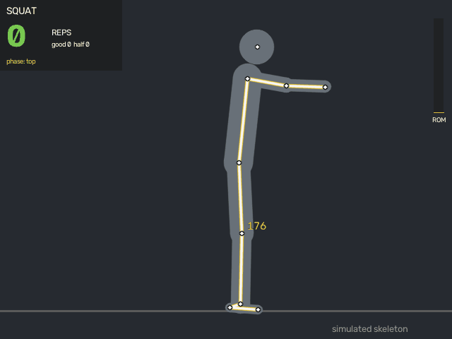
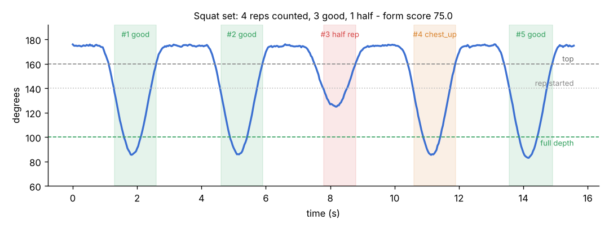
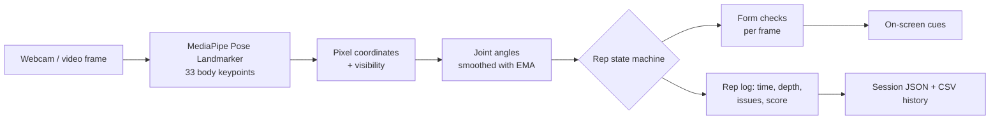

# AI Rep Counter & Form Checker

[](https://github.com/coach-who-codes/ai-rep-counter/actions/workflows/ci.yml)


**Computer vision that does what I do as a personal trainer: count reps, catch half reps and call out bad form - in real time, from a webcam or a phone video.**

<p align="center">
  
</p>

<p align="center"></p>

*The demo runs the real counting engine on a simulated skeleton, so it's reproducible without a camera. On real video the only difference is that the joints come from MediaPipe instead of the simulator.*

---

## Why I built this

I coach clients in person and online. Online coaching has one big gap: **nobody is watching the reps**. Clients send videos, and I count reps and point out form issues by hand. This project automates that first pass - and every session it logs feeds my second project, [**client-dropout-predictor**](https://github.com/coach-who-codes/client-dropout-predictor), which predicts which clients are about to quit.

## What it does

| | Squat | Push-up | Bicep curl |
|---|---|---|---|
| Tracked angle | knee (hip-knee-ankle) | elbow (shoulder-elbow-wrist) | elbow (shoulder-elbow-wrist) |
| Full rep = | thighs ~parallel (knee <= 100 deg) | chest near floor (elbow <= 95 deg) | full squeeze (elbow <= 55 deg) |
| Form checks | chest up (torso lean) | hips sagging / piking (body line) | elbow drift, torso swing |
| Ignores | - | arm movement while standing | - |

- **Counts reps the way a coach does** - only when you return to the start position.
- **Flags half reps** instead of silently counting them.
- **Scores every rep** (100 points, -25 per form fault, half rep = 0) and gives a session **form score**.
- **Live coaching cues** on screen ("Go deeper", "Keep your chest up", "Good rep! (1.3s)").
- **Rep tempo** per rep, plus a range-of-motion bar.
- **Logs every session** to JSON + a CSV history per client.
- Works facing left or right; picks the body side the camera sees best.

## How it works



1. **Pose estimation** - MediaPipe's Pose Landmarker (a pretrained CNN) finds 33 body keypoints per frame. VIDEO mode tracks between frames for stability.
2. **Geometry** - normalised keypoints are converted to pixels (otherwise width/height scaling distorts angles), then the joint angle is computed with the dot-product formula.
3. **Smoothing** - an exponential moving average removes keypoint jitter.
4. **State machine** - `WAITING -> TOP -> DOWN -> BOTTOM -> TOP`. Three thresholds (top / rep-started / full-depth) give hysteresis, so noise around one threshold can't double count. Reps faster than 0.4s are rejected as tracking glitches.
5. **Form rules** - each exercise checks its own faults while a rep is in progress; faults are attached to that rep.

More detail and trade-offs in [docs/DESIGN.md](docs/DESIGN.md).

## Quickstart

```bash
git clone https://github.com/coach-who-codes/ai-rep-counter.git
cd ai-rep-counter
python -m venv .venv && source .venv/bin/activate   # Windows: .venv\Scripts\activate
pip install -r requirements.txt
pip install -e .
```

**Live webcam** (stand side-on, whole body in frame; `q` quits, `r` resets):

```bash
python -m repcounter --exercise squat
```

**Analyse a recorded set** and save an annotated video:

```bash
python -m repcounter --exercise squat --source my_set.mp4 --output annotated.mp4 --no-display --client C042
```

Summary printed for the demo set shown at the top:

```
Exercise      : squat
Reps counted  : 4  (good form: 3, half reps: 1)
Form score    : 75.0 / 100
Avg rep tempo : 1.31 s
Form issues   : too_shallow x1, chest_up x1
```

It also writes `logs/<timestamp>_<client>_<exercise>.json` (every rep + the angle trace) and appends a row to `logs/workout_log.csv`.

**Web app** (upload a video, get metrics, an angle chart, a rep table and the annotated video):

```bash
streamlit run app/streamlit_app.py
```

The pose model (~5 MB) downloads automatically on first run. Use `--model-variant full` for better accuracy on harder angles.

## Tests

The counting logic is tested against a **kinematic simulator** (`src/repcounter/simulate.py`) that builds skeletons with *known* joint angles - so every test has an exact ground truth, and CI needs no camera, GPU or model download.

```bash
pytest -q        # 52 tests: geometry, rep counting, half reps, jitter, form faults, logging
```

## Project structure

```
src/repcounter/
  geometry.py    joint angles, line offsets, EMA smoothing
  landmarks.py   MediaPipe keypoint map, Pose container, best-side selection
  exercises.py   per-exercise thresholds + form rules (add a new exercise here)
  counter.py     rep state machine, rep scoring
  session.py     session summary, JSON + CSV logging
  detector.py    MediaPipe Pose Landmarker wrapper, model download
  overlay.py     skeleton + HUD drawing
  pipeline.py    video -> pose -> reps loop (used by CLI and app)
  simulate.py    synthetic skeletons for tests and the demo
app/streamlit_app.py   upload-a-video web app
scripts/               demo + GIF helpers
tests/                 pytest suite
```

## Limitations & roadmap

- **2D angles** need a side-on camera; a front view under-reads knee and elbow angles. Next: use MediaPipe's 3D world landmarks for view-independent angles.
- **Rule-based form checks** encode coaching knowledge but don't learn. Next: label my own clients' reps (good / fault) and train a small sequence classifier (1D-CNN or GRU) on the angle traces.
- More exercises: lunges, shoulder press, deadlift hip hinge.
- Real-time voice cues and a mobile build.

## Author

**Amit Dubey** - personal trainer turned ML engineer. I build AI for the problems I see on the gym floor.
GitHub [@coach-who-codes](https://github.com/coach-who-codes) - Instagram [@muscleaddict_amit](https://instagram.com/muscleaddict_amit)
